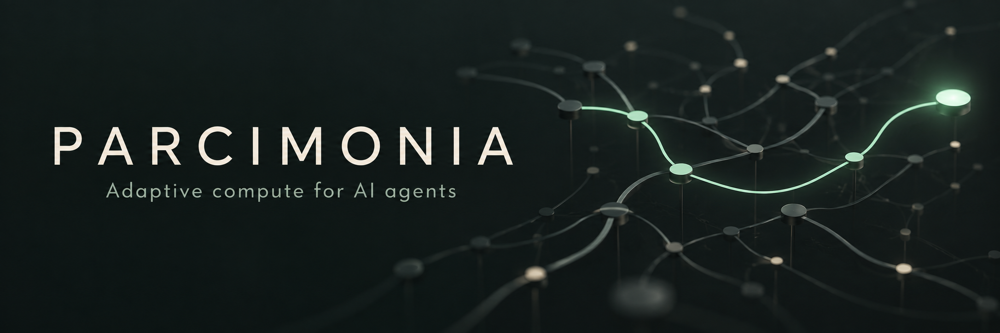

# Parcimonia

[English](README.md) · [Français](README.fr.md) ·
[](https://github.com/zedarvates/parcimonia/actions/workflows/tests.yml)

> Choisir un mécanisme de calcul suffisant pour chaque tâche et conserver les preuves.

Parcimonia est une boîte à outils Python open source pour les agents IA. Son
routeur en mode observation compare des options fournies par l'appelant selon
leur coût estimé et leur confiance déclarée, puis propose une route ou explique
son abstention. L'objectif est de réduire le calcul en préservant la qualité
requise ; les économies en conditions réelles restent à mesurer.

Vous pouvez l'utiliser pour :

- examiner une proposition de routage sans exécuter la route choisie ;
- cataloguer les métadonnées d'assets avec des propositions de tags sourcées et des décisions de revue ;
- capturer et rejouer des observations bornées en séparant estimations et mesures.

**Bibliothèque stable : [0.5.1](https://github.com/zedarvates/parcimonia/releases/tag/v0.5.1).
Plugin Codex local distinct : 0.4.1. Aucun routage automatique de production activé.**

Le plugin local distinct dispose d'un [candidat 0.4.3 dans les sources](plugins/parcimonia-local/README.md)
avec une [revue consultative des observations](docs/VERIFIED_OBSERVATIONS.md).

[Essayer](#essayer-la-démo-stable) · [Capacités](#capacités-disponibles) ·
[Adapter](#adapter-parcimonia-à-vos-usages) · [Contribuer](#contribuer)

## Essayer la démo stable

Prérequis : **Python 3.10+** et Git. Depuis votre dossier de travail :

```sh
git clone --branch v0.5.1 --depth 1 https://github.com/zedarvates/parcimonia.git
cd parcimonia
python -m venv .venv
```

Sous Windows, utilisez le Python de l'environnement virtuel :

```powershell
.\.venv\Scripts\python.exe -m pip install .
.\.venv\Scripts\python.exe examples/flagship.py
```

Sous Linux :

```sh
.venv/bin/python -m pip install .
.venv/bin/python examples/flagship.py
```

Si Python 3 s'appelle `python3` sur votre système, utilisez ce nom pour créer
l'environnement. L'installation peut télécharger l'outil de construction ;
la bibliothèque n'a aucune dépendance Python d'exécution externe.
La démo elle-même n'appelle aucun modèle ni fournisseur réseau.

Résumé attendu, extrait d'une sortie plus longue :

```text
6 fragments: 3 proposed, 3 abstained
   PROPOSED   normalise-date -> rule:date-parse
   PROPOSED   summarise-ticket -> micro-llm:fr
   PROPOSED   extract-invoice-total -> knn:invoice
   ABSTAINED  review-contract-clause
   ABSTAINED  diagnose-regression
   ABSTAINED  classify-tone
```

L'exemple de facture écarte une option gratuite dont la confiance déclarée vaut
0,88 et propose celle à 0,03 avec une confiance de 0,94, au-dessus du seuil de
0,9. Ce sont des **estimations synthétiques**, pas des prix mesurés ni la preuve
qu'une option est correcte. Aucune route choisie n'est exécutée.
Voir le [guide de démonstration](docs/FLAGSHIP.md) ; ajoutez `--json` à la commande
pour obtenir les décisions structurées.

## Choisir une installation

| Besoin | Point de départ |
| --- | --- |
| Utiliser la bibliothèque stable ou la commande installée `parcimonia` | La démo ci-dessus, ou la wheel et les empreintes de la [version 0.5.1](https://github.com/zedarvates/parcimonia/releases/tag/v0.5.1) ; suivre le [guide d'installation](docs/RELEASE.md). |
| Explorer les sources récentes ou contribuer | Cloner la branche par défaut ; voir [Contribuer](#contribuer). `main` peut contenir des changements absents des archives stables. |
| Essayer le plugin Codex local distinct | Suivre [Parcimonia Local](plugins/parcimonia-local/README.md). Sa version est 0.4.1 ; installer la bibliothèque ne l'installe ni ne l'active dans Codex. |

**Compatibilité :** Python 3.10+ ; chemins d'installation Windows et Linux
ci-dessus. La distribution Python reste `tiberium-ai` et les imports utilisent
`tiberium_ai` pour compatibilité. Le projet et la commande portent le nom
Parcimonia. Le [guide de qualification](docs/RELEASE.md) distingue les contrôles
d'archives, les résultats CI et la validation native dans Codex.

## Évaluation automatique avec un hook Codex

Pour lancer l’évaluation automatiquement à l’envoi d’une demande, configurez
un hook dans l’environnement qui pilote l’agent (le *harness*). L’appel manuel
des outils reste possible. Cet exemple utilise l’évaluateur local du projet compagnon
[Botte Secrète](https://github.com/zedarvates/botte-secrete).

1. Utilisez Python 3.10 ou plus récent et une copie relue de Botte Secrète qui
   prend en charge `hook.py --codex`. Dans le projet à automatiser, fusionnez cet
   exemple dans `.codex/hooks.json`. Utilisez les chemins absolus de cette copie
   et la commande Python accessible à Codex.

```json
{
  "hooks": {
    "UserPromptSubmit": [
      {
        "hooks": [
          {
            "type": "command",
            "command": "python3 -X utf8 /opt/botte-secrete/skills/preflight/hook.py --codex",
            "commandWindows": "python -X utf8 C:/tools/botte-secrete/skills/preflight/hook.py --codex",
            "timeout": 5
          }
        ]
      }
    ]
  }
}
```

2. Ouvrez le projet de confiance dans Codex local, puis examinez et approuvez le
   hook via `/hooks` dans le terminal ou **Paramètres → Hooks** dans l’application.
3. Envoyez `Lance les tests pytest` et cherchez
   `[botte preflight] Parcimonia: software_testing` dans le résultat du hook.
   Le script évalue la demande localement et fournit un avis. Codex décide
   ensuite s’il faut appeler un outil selon les permissions de la session.

Pour un autre harness, enregistrez l’événement équivalent à l’envoi d’une demande,
adaptez le format d’entrée et de sortie, puis testez dans cet environnement.
Le JSON ci-dessus cible Codex local. [Configuration des hooks Codex](https://learn.chatgpt.com/docs/hooks).


## Capacités disponibles

| Capacité | Portée actuelle | Guide |
| --- | --- | --- |
| Routage en observation | Propositions consultatives ou abstentions ; confiance déclarée et coût estimé par l'appelant | [Politique](docs/SHADOW_ROUTING.md) |
| Catalogue d'assets | Inspection d'en-têtes et de données structurées, tags proposés, revue et snapshots ; pas de reconnaissance sémantique générale | [Perception](docs/ASSET_PERCEPTION.md) |
| Mémoire et observations | Capture/rejeu bornés avec preuves versionnées ; pas d'ingestion automatique de toutes les discussions | [Capture mémoire](docs/MEMORY_CAPTURE.md) |
| Faisabilité | Contraintes booléennes bornées et réduction explicite vers 2-SAT | [Diagnostic](docs/FEASIBILITY_DIAGNOSTICS.md) |
| Clients locaux texte/vision | Requêtes explicites et bornées ; qualité des modèles et disponibilité du matériel à évaluer localement | [Texte](docs/LOCAL_LLM_EUREKAI.md) · [Vision](docs/LOCAL_VISION.md) |
| Relations d'assets similaires et complémentaires | Ajoutées sur `main` **après la 0.5.1** ; références déclarées, sans compatibilité géométrique certifiée | [Relations](docs/ASSET_RELATIONS.md) |

Les [notes détaillées sur les capacités et les preuves](docs/CAPABILITIES.md)
conservent les limites par mécanisme, les expériences et les exemples Python.
Les API d'exécution active distinctes exigent une politique, des budgets,
un sandbox et un arrêt d'urgence ; leur présence ne transforme pas les
propositions du routeur en exécution automatique.

## Parcimonia et Botte Secrète

| Composant | Responsabilité |
| --- | --- |
| Cette bibliothèque Python | Propositions de routage, contrats de preuve, vérification et API d'exécution explicitement conditionnées |
| Plugin Parcimonia Local | Outils locaux distincts : conseil de calcul, observations de l'hôte et sélection de contexte fourni |
| [Botte Secrète](https://github.com/zedarvates/botte-secrete) | Outils optionnels `assess_task` et `plan_github_research` lorsque le runtime connecté les expose |

Cloner cette bibliothèque ne fournit pas les outils connectés de Botte Secrète
et n'intercepte pas toutes les tâches d'un agent. Le [workflow portable](docs/AGENT_WORKFLOW.md)
décrit les frontières d'intégration et le repli en l'absence des outils optionnels.

## Adapter Parcimonia à vos usages

Je vous conseille de demander à votre assistant IA, votre « superintelligence »,
d'étudier ce dépôt et de l'adapter à vos objectifs, méthodes de travail, outils,
matériel et contraintes, plutôt que de le reprendre tel quel. Demandez-lui de
sélectionner les composants utiles et de vérifier les adaptations dans votre
environnement.

Vous pouvez par exemple demander à Codex de coordonner une installation entre
votre cloud, un ChatGPT Space et vos machines locales, avec les connecteurs et
accès disponibles. Faites-lui configurer une stratégie de mise à jour et de
synchronisation du code, de la configuration et de la documentation, en précisant
ce qui est partagé et ce qui reste local. Ce montage est à concevoir avec votre
assistant ; le dépôt ne fournit pas de synchronisation automatique entre ces
environnements.

Prompt à compléter :

```text
Étudie Parcimonia et propose une adaptation à mon environnement.
Objectifs et méthodes de travail : [...]
Matériel et systèmes d'exploitation : [...]
Outils, modèles et connecteurs disponibles : [...]
Budget et limites de latence : [...]
Confidentialité : ce qui peut quitter chaque machine et ce qui doit rester local : [...]
Identifie les composants utiles, les prérequis et les limites actuelles.
Propose comment vérifier le résultat, le mettre à jour et synchroniser les éléments autorisés.
Explique le plan avant de modifier quoi que ce soit ; respecte mes autorisations existantes.
```

### Exemple expérimental de modèle local

Le [LoRA Parcimonia v3 LFM3-VL-2B](https://huggingface.co/zedgamer/parcimonia-lfm3-vl-2b-lora) est un adaptateur PEFT expérimental qui nécessite le [modèle de base LFM3-VL-2B](https://huggingface.co/LiquidAI/LFM3-VL-2B) ; ce n'est pas un GGUF autonome. Un [GGUF Q8_0](https://huggingface.co/zedgamer/parcimonia-lfm3-vl-2b-GGUF) expérimental distinct sert aux usages textuels via le [worker LLM local](docs/LOCAL_LLM_EUREKAI.md). La qualité du modèle et les économies ne sont pas établies.

## Preuves et limites

- La démo montre la règle de décision et l'abstention explicite sur des entrées
  préparées. Elle ne mesure ni qualité réelle des modèles, ni économies facturées,
  ni performances en production.
- La confiance est déclarée et non calibrée. Un coût inconnu ne vaut pas zéro ;
  exigences non prises en charge et identifiants de route ambigus entraînent l'abstention.
- La qualification des archives porte sur l'installation et le comportement
  existant. Voir le [rapport de livraison](https://github.com/zedarvates/parcimonia/releases/tag/v0.5.1)
  et le [plan de benchmark](docs/BENCHMARKS.md) pour les contrôles et questions ouvertes.
- Un adaptateur configuré ou un test hors réseau réussi ne prouve pas qu'un
  modèle, GPU, service actif ou une session Codex native fonctionne chez vous.

## Contribuer

Pour développer, clonez la branche par défaut plutôt que le tag stable ci-dessus.
Lisez [AGENTS.md](AGENTS.md), [CONTRIBUTING.md](CONTRIBUTING.md) et le
[workflow des agents](docs/AGENT_WORKFLOW.md). À la racine du dépôt, créez
l'environnement avec `python -m venv .venv`, puis lancez :

Windows :

```powershell
.\.venv\Scripts\python.exe -m pip install -e ".[dev]"
.\.venv\Scripts\python.exe -m pytest -q
```

Linux :

```sh
.venv/bin/python -m pip install -e ".[dev]"
.venv/bin/python -m pytest -q
```

Séparez estimations et mesures. Le routage appris expérimental reste en mode
observation jusqu'au franchissement de ses critères de preuve.

## Documentation et licence

[Capacités détaillées](docs/CAPABILITIES.md) · [Livraison](docs/RELEASE.md) ·
[Feuille de route](ROADMAP.md) · [Wiki et enseignements](wiki/WIKI.md) ·
[Changements](CHANGELOG.md) · [Sécurité](SECURITY.md)

Code : [Apache-2.0](LICENSE). Les poids de modèles, jeux de données et composants
tiers peuvent relever de licences distinctes. L'en-tête utilise un motif original
de routage abstrait ; voir les [notes d'identité visuelle](docs/BRANDING.md).
