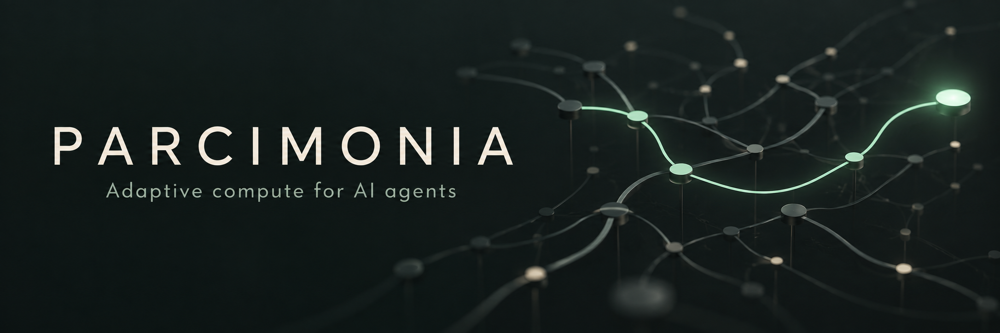

# Parcimonia

[English](README.md) · [Français](README.fr.md) ·
[](https://github.com/zedarvates/parcimonia/actions/workflows/tests.yml)

> Choose a sufficient compute mechanism for each task, and keep the evidence.

Parcimonia is an open-source Python toolkit for AI agents. Its shadow router
compares caller-supplied options by estimated cost and declared confidence,
then proposes a route or explains why it abstains. The aim is to spend less
compute while preserving required quality; real-world savings remain unmeasured.

You can use it to:

- inspect a proposed routing decision without executing the selected route;
- catalogue asset metadata with source-bound tags and review decisions;
- capture and replay bounded observations while separating estimates from measurements.

**Stable library: [0.5.1](https://github.com/zedarvates/parcimonia/releases/tag/v0.5.1).
Separate local Codex plugin: 0.4.1. No automatic production routing is enabled.**

[Try it](#try-the-stable-demo) · [Capabilities](#available-capabilities) ·
[Adapt it](#adapt-parcimonia-to-your-own-use) · [Contribute](#contributing)

## Try the stable demo

Requires **Python 3.10+** and Git. From your chosen working directory:

```sh
git clone --branch v0.5.1 --depth 1 https://github.com/zedarvates/parcimonia.git
cd parcimonia
python -m venv .venv
```

On Windows, use the virtual environment's Python:

```powershell
.\.venv\Scripts\python.exe -m pip install .
.\.venv\Scripts\python.exe examples/flagship.py
```

On Linux:

```sh
.venv/bin/python -m pip install .
.venv/bin/python examples/flagship.py
```

If your system calls Python 3 `python3`, use that for creating the environment.
Installation may download the build backend; the library has no external Python
runtime dependencies. The demo itself calls no model or network provider.

Expected summary, extracted from the longer output:

```text
6 fragments: 3 proposed, 3 abstained
   PROPOSED   normalise-date -> rule:date-parse
   PROPOSED   summarise-ticket -> micro-llm:fr
   PROPOSED   extract-invoice-total -> knn:invoice
   ABSTAINED  review-contract-clause
   ABSTAINED  diagnose-regression
   ABSTAINED  classify-tone
```

The invoice example rejects a free option with declared confidence 0.88 and
proposes a 0.03-cost option at 0.94, above the demo's 0.9 threshold. These are
**synthetic estimates**, not measured prices or proof that an option is correct.
No selected route is executed. See the [walkthrough](docs/FLAGSHIP.md);
add `--json` to the demo command for structured decisions.

## Choose an installation

| Need | Starting point |
| --- | --- |
| Use the stable library or installed `parcimonia` command | The demo above, or the wheel and checksums in [release 0.5.1](https://github.com/zedarvates/parcimonia/releases/tag/v0.5.1); follow the [installation guide](docs/RELEASE.md). |
| Explore newer source or contribute | Clone the default branch; see [contributing](#contributing). `main` can contain changes absent from the stable archives. |
| Try the separate local Codex plugin | Follow [Parcimonia Local](plugins/parcimonia-local/README.md). Its version is 0.4.1; a library installation does not install or activate it in Codex. |

**Compatibility:** Python 3.10+; installation paths for Windows and Linux are
shown above. The Python distribution is still `tiberium-ai` and imports use
`tiberium_ai` for compatibility. The project and installed CLI are Parcimonia.
[Release qualification](docs/RELEASE.md) distinguishes archive checks, CI results
and native Codex validation.

## Available capabilities

| Capability | Current scope | Guide |
| --- | --- | --- |
| Shadow routing | Advisory proposals or abstentions; caller-declared confidence and estimated cost | [Routing policy](docs/SHADOW_ROUTING.md) |
| Asset catalogue | Header/structured-data inspection, proposed tags, review and snapshots; not general semantic recognition | [Asset perception](docs/ASSET_PERCEPTION.md) |
| Memory and observations | Bounded capture/replay with versioned evidence; no automatic ingestion of every conversation | [Memory capture](docs/MEMORY_CAPTURE.md) |
| Feasibility checks | Bounded Boolean requirements and explicit 2-SAT reduction | [Diagnostics](docs/FEASIBILITY_DIAGNOSTICS.md) |
| Local text/vision clients | Explicit, bounded requests; model quality and hardware readiness require local evaluation | [Text](docs/LOCAL_LLM_EUREKAI.md) · [Vision](docs/LOCAL_VISION.md) |
| Similar and complementary asset relations | Added on `main` **after 0.5.1**; declared references, not certified geometric compatibility | [Relations](docs/ASSET_RELATIONS.md) |

The [detailed capability and evidence notes](docs/CAPABILITIES.md) retain the
per-mechanism limits, experiments and Python examples. Separate active execution
APIs require a policy, budgets, a sandbox and a kill switch; their presence does
not turn shadow proposals into automatic execution.

## Parcimonia and Botte Secrète

| Component | Responsibility |
| --- | --- |
| This Python library | Routing proposals, evidence contracts, verification and explicitly gated execution APIs |
| Parcimonia Local plugin | Separate local tools for advisory compute planning, host observations and supplied-context selection |
| [Botte Secrète](https://github.com/zedarvates/botte-secrete) | Optional `assess_task` and `plan_github_research` tools when the connected runtime exposes them |

Cloning this library does not supply Botte Secrète's connected tools or intercept
all of an agent's tasks. See the [portable agent workflow](docs/AGENT_WORKFLOW.md)
for the integration boundaries and fallback when optional tools are unavailable.

## Adapt Parcimonia to your own use

I recommend asking your AI assistant (your “superintelligence”) to study this
repository and adapt it to your own goals, workflows, tools, hardware and
constraints, rather than adopting it unchanged. Ask it to select the useful
components and verify the adaptations in your environment.

For example, ask Codex to coordinate a setup across your cloud, a ChatGPT Space
and your local machines, using the available connectors and access. Have it
configure an update and synchronization strategy for code, configuration and
documentation, specifying what is shared and what stays local. This is a setup
to design with your assistant; the repository does not provide automatic
cross-environment synchronization.

Prompt to fill in:

```text
Study Parcimonia and propose an adaptation for my environment.
Goals and workflows: [...]
Hardware and operating systems: [...]
Available tools, models and connectors: [...]
Budget and latency limits: [...]
Privacy: what may leave each machine, and what must stay local: [...]
Identify useful components, prerequisites and current limits.
Propose how to verify the result, update it and synchronize approved parts.
Explain the plan before making changes; respect my existing permissions.
```

## Evidence and limits

- The demo demonstrates the decision rule and explicit abstention on authored
  inputs. It does not establish real model quality, billed savings or performance.
- Confidence is caller-declared and uncalibrated. Unknown cost is not zero;
  unsupported requirements and ambiguous route IDs cause abstention.
- Published archive qualification covers installation and existing behavior.
  See the [release report](https://github.com/zedarvates/parcimonia/releases/tag/v0.5.1)
  and [benchmark plan](docs/BENCHMARKS.md) for what was checked and what remains.
- A configured adapter or a passing offline fixture does not establish that a
  model, GPU, live service or native Codex session works in your environment.

## Contributing

For development, clone the default branch instead of the stable tag above.
Read [AGENTS.md](AGENTS.md), [CONTRIBUTING.md](CONTRIBUTING.md) and the
[agent workflow](docs/AGENT_WORKFLOW.md). From the repository root, create a
virtual environment with `python -m venv .venv`, then run:

Windows:

```powershell
.\.venv\Scripts\python.exe -m pip install -e ".[dev]"
.\.venv\Scripts\python.exe -m pytest -q
```

Linux:

```sh
.venv/bin/python -m pip install -e ".[dev]"
.venv/bin/python -m pytest -q
```

Keep estimates separate from measurements and experimental learned routing in
shadow mode until its evidence gates are met.

## Documentation and license

[Detailed capabilities](docs/CAPABILITIES.md) · [Release guide](docs/RELEASE.md) ·
[Roadmap](ROADMAP.md) · [Wiki and lessons learned](wiki/WIKI.md) ·
[Changes](CHANGELOG.md) · [Security](SECURITY.md)

Code: [Apache-2.0](LICENSE). Model weights, datasets and third-party components
may require separate licenses. The header uses an original abstract routing
motif; see [visual identity notes](docs/BRANDING.md).
