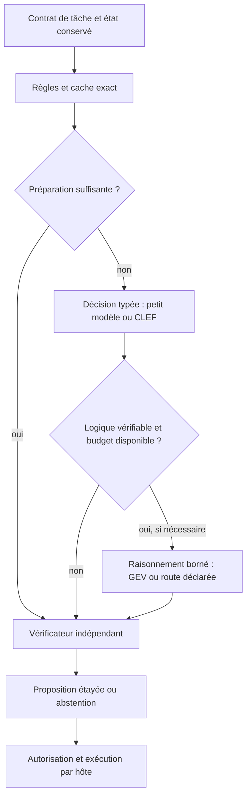

# CLEF et GEV : améliorations proposées pour Parcimonia

**Statut : proposition d’architecture et d’expériences. Date : 7 octobre 2026.**

Mise à jour : le premier incrément de correction des contrats a été réalisé
après cette analyse ; voir [les contrats et leur migration](DECISION_CONTRACTS.md).
Les constats ci-dessous décrivent l’état observé avant cette correction.

La priorité est de fiabiliser les contrats, la sémantique des champs et la
calibration, puis de comparer des backends interchangeables. Les modèles étudiés
sont des candidats pour des décisions bornées ; leur adoption doit montrer un
avantage sur une tâche vérifiée, avec le coût de toute la chaîne.

L’analyse concerne le dépôt `C:\TiberiumAI`, projet public Parcimonia, package
`tiberium_ai`. HEAD consulté : `0c2404fd949ce5d1edf4e852ae546f95d9fbc6fe`.
Les backends Laya/Jeff, les recettes d’agents et la cascade sont présents dans
le travail local non commité. Leur présence ici ne prouve pas leur disponibilité
dans une version publiée. Leurs fichiers ont été conservés.

## Ce que montrent les deux références

| Référence | Mécanisme publié | Intérêt pour notre projet |
|---|---|---|
| CLEF | Backbone 27B multimodal et tête commune : plusieurs questions et leurs options sont évaluées ensemble, sans génération libre | Tester le coût d’un état partagé et la cohérence d’une signature complète |
| GEV-26B-Decide | Backbone Gemma 26B, environ 4B actifs ; décision rapide, puis raisonnement optionnel | Adapter le recours au raisonnement à la famille de tâche et au budget |

[Fiche CLEF figée](https://huggingface.co/Cloudflare/clef/blob/2f3de3dd85f379784083b0814d997ab627200f0c/README.md),
[fiche GEV figée](https://huggingface.co/autotrust/GEV-26B-Decide/blob/7c89590ead085bf77630b4bf68264ea30b6ddc78/README.md).

GEV rapporte un recul de macro-F1 sur BANKING77, de 88 à 85 avec raisonnement,
et recommande de le désactiver pour classification, recherche et routage.
Le modèle peut être confiant et faux. Ses mesures sur B200 et celles de CLEF
sur H200 ne prédisent pas notre latence locale. Les 4B actifs de GEV ne signifient
pas que seuls 4B paramètres doivent être stockés. Ces résultats sont ceux des
auteurs ; aucun des deux modèles n’a été exécuté pendant cette analyse.
[Résultats et limites GEV](https://huggingface.co/autotrust/GEV-26B-Decide/blob/7c89590ead085bf77630b4bf68264ea30b6ddc78/README.md).

Cloudflare décrit une attention entre champs et un entraînement avec perte Brier
et permutations des schémas. Cela suggère deux expériences distinctes chez nous :
mesurer les incohérences entre réponses et vérifier la stabilité quand l’ordre
des questions ou des options change.
[Architecture publiée par Cloudflare](https://blog.cloudflare.com/clef-decision-models/).

## Ce qui existe et qu’il faut réutiliser

- `reflex.py` : `choice`, `score`, `noul`, validation des distributions et abstention.
- `decision_adapter.py` : captures, rejeu, vérificateurs de schéma, décomposition
  et classement d’ensembles d’options. La décomposition existe déjà ; les plafonds
  sont actuellement 20 options par étape et 255 dans l’ensemble.
- `signature_cascade.py` : baseline suivie d’un secours, budgets d’appels, validation
  des lots complets. Le déclenchement dépend uniquement de la probabilité du type.
- `decision_clock.py`, `escalation.py`, `resources.py`, `benchmark.py` : bornes
  temporelles, escalade, coûts séparés et comparaison tenue à l’écart.
- `agent_recipes/core.py` : JSON canonique, traces et budgets ; `cache.py` : cache
  exact ; `browser.py` : sélection liée à un instantané et vérificateur de fin.

La décision proposée ne donne pas d’autorisation d’exécuter. L’intention et
l’autorisation restent au directeur/hôte, la vérification au vérificateur.

## Priorités de correction confirmées localement

Trois sondes synthétiques ont été exécutées hors réseau, sans modèle ni action
externe. Elles sont reproductibles dans
`runs/research-clef-gev-20261007/probe_contracts.py` ; leurs résultats et les hashes
des sources locales sont dans `contract-probes.json`.

### P0 — Lier la calibration à la question et au backend

`reflex.py:308` applique le même `CalibrationSnapshot` aux réponses du lot.
La méthode `permits_auto_act` ne vérifie pas que `task_family` correspond à la
question, ni l’identité du modèle ou du schéma. La sonde applique une calibration
`unrelated.question` à `kind` et obtient `auto_act_allowed=true`.
Ce résultat concerne un drapeau interne ; aucune action n’a été exécutée et les
portes d’autorisation de l’hôte restent distinctes.

Proposition : identité de calibration contenant question/famille, backend,
révision, schéma, langue et protocole de confiance ; refus de toute incompatibilité.
Un lot reçoit des calibrations par question. Séparer explicitement probabilité
brute, score heuristique et confiance calibrée ; ne pas comparer leurs seuils
comme s’il s’agissait de la même quantité.

### P0 — Préserver le sens de l’état JSON

`ReflexEngine.evaluate`, `reflex.py:262`, concatène les valeurs d’un mapping.
Les deux états synthétiques `{"amount":100,"limit":200}` et
`{"limit":100,"amount":200}` arrivent tous deux au backend sous la forme
`100 200`. La relation entre champs disparaît.

Proposition : sérialisation canonique conservant clés, imbrication et types,
en réutilisant la convention de `agent_recipes/core.py`. Versionner cette
transformation, car captures, hashes et caches en dépendent. L’entrée via
`DecisionSession` est déjà sérialisée avant Reflex ; le défaut démontré concerne
le passage direct d’un mapping à Reflex.

### P1 — Unifier la normalisation des réponses des fournisseurs

Le code officiel de CLEF arrondit les probabilités à quatre décimales ; son
encodage coupe également les tokens de l’état lorsque la limite est atteinte.
Une intégration doit vérifier le budget avant encodage ou constater exactement
les tokens retirés et refuser l’entrée tronquée.
[Code CLEF figé](https://huggingface.co/Cloudflare/clef/blob/2f3de3dd85f379784083b0814d997ab627200f0c/joint_schema_model.py).

La sonde injecte une réponse représentative, avec trois probabilités à `0.3333` :
le chemin `TypeSafeBackend` → Reflex refuse la somme `0.9999`, alors que
`LayaBackend` accepte l’écart d’arrondi borné et renormalise. La réponse injectée
n’est pas une capture d’inférence CLEF.

Proposition : extraire un normaliseur partagé des règles existantes de Laya,
conserver la réponse brute, refuser options inconnues et valeurs non finies,
et limiter la tolérance à la précision réellement déclarée par le fournisseur.
Contrôler aussi la cohérence entre choix, probabilité et score annoncé.

## Améliorations fonctionnelles à expérimenter

### P1 — Définir les champs avant d’ajouter un modèle

`task_signature.py:234` demande si l’entrée *fournit* un champ. Certains labels
de `signature_corpus.py` décrivent plutôt une information nécessaire au travail.
Cette ambiguïté empêche de savoir quelle erreur on veut corriger.

Proposition : distinguer `provided_fields`, `required_context` et
`missing_context`, avec exemples positifs, négatifs et inconnus. Un champ absent
ne doit pas devenir un champ fourni parce que le travail en a besoin. Réannoter
un lot de développement, puis geler un lot indépendant avec ce contrat.

Les captures locales relues confirment : Laya accepte correctement 3 types sur 6,
Jeff 4, la baseline verbes/objets 4. Pour les champs des cas couverts, les deux
bras neuronaux ont précision et rappel nuls. Le rappel de la baseline est nul ;
sa précision est indéfinie, puisqu’elle n’en sélectionne aucun.
Ce sont six fixtures, pas une estimation sur les demandes réelles.

### P1 — Faire porter l’escalade sur les besoins de la décision

Le contrôle du seul `kind` peut conserver un lot dont les champs requis ne sont
pas fiables. Ajouter un verdict de préparation : type suffisamment étayé,
contexte nécessaire disponible, contraintes vérifiées et réponses compatibles.
Conserver le remplacement d’un lot complet, ou définir un assemblage versionné
avec provenance par réponse et vérification de cohérence. Une fusion improvisée
des meilleures réponses de chaque fournisseur changerait le protocole.

Pour classification et sélection d’outils, comparer règles/cache/petit modèle
puis décision typée plus forte. Pour une contrainte logique vérifiable, comparer
un raisonnement borné. Un seuil de probabilité isolé ne garantit pas que le
raisonnement sera utile ; évaluer aussi les erreurs très confiantes.

### P2 — Réduire les passes et comparer CLEF-Flash

Jeff traite actuellement onze questions par onze passes, pour borner les buffers
CPU (`jeff_backend.py:61`). La capture historique donne environ 7,71 s par cas,
contre 403 ms pour Laya qui groupe les onze questions. Cela mesure ces intégrations
et leur matériel ; cela ne démontre pas une supériorité intrinsèque du modèle.

Comparer : type seul, questions nécessaires, petits lots, puis tête commune.
Les passes Jeff groupées en batch ne sont pas équivalentes à une tête partageant
un unique encodage de l’état. Mesurer temps et mémoire, et conserver la référence
séquentielle. Pour une première comparaison CLEF, considérer aussi
CLEF-Flash, annoncé sur Qwen3.5-9B, après un examen des ressources disponibles.
[Fiche CLEF-Flash figée](https://huggingface.co/Cloudflare/clef-flash/blob/17f0b0ad64efb65d273590632833508766b2aae6/README.md).

### P2 — Déclarer les capacités réelles de chaque backend

Proposer un manifeste : types de questions, plafond natif d’options, questions
par appel, modalités, contexte, comportement de troncature et version de
calibration. Le backend doit être interchangeable sans perdre ces différences.

GEV expose une question par `/v1/decide`, des scores canoniques 0–5 et une lecture
native de 16 options. Au-delà, le serveur compose des distributions par tournoi.
Il expose aussi les tokens de raisonnement, sa fin dans le budget et le nombre
de requêtes internes. Enregistrer ces informations ; identifier les probabilités
composées séparément des probabilités natives. Fixer un budget explicite et
tester une pensée interrompue, dont le résultat n’est pas une preuve suffisante.
[Serveur GEV figé](https://huggingface.co/autotrust/GEV-26B-Decide/blob/7c89590ead085bf77630b4bf68264ea30b6ddc78/serve_decide.py).

Le coût cumulé doit compter les passes internes, le chargement, le cache,
les vérificateurs et la file d’attente. Compléter les mesures médianes par p95,
respect des échéances et mémoire maximale. Mettre mode de raisonnement,
calibration et stratégie d’options dans l’identité des captures et du cache.

## Options d’architecture et compromis

| Option | Complexité et ressources | Décision proposée |
|---|---|---|
| Fiabiliser contrats + règles/Laya/Jeff existants | Faible à moyenne ; réalisable sans GPU | Premier incrément |
| Ajouter CLEF/CLEF-Flash en adaptateur optionnel | Moyenne ; poids et mémoire supplémentaires | Après contrat et corpus ; comparer le traitement commun des questions |
| Ajouter GEV en adaptateur optionnel | Moyenne à forte ; runtime vLLM spécifique et raisonnement coûteux | Pour les familles où un gain est vérifiable |
| Réentraîner une tête compacte spécialisée | Forte ; nécessite des labels fiables et une vraie séparation entraînement/test | Expérience ultérieure si les traces établissent le besoin |

Le README du projet décrit déjà une base de routage et de preuves plus large
qu’un classifieur. La différenciation à développer est le choix d’un mécanisme
selon sa preuve et son coût total, avec retour à la baseline lorsque nécessaire.

## Protocole de validation proposé

1. Corriger les trois contrats reproduits, avec vérification des identités,
   collisions JSON, arrondis et refus de troncature. Versionner les changements.
2. Clarifier la sémantique des champs et préparer un premier lot indépendant
   français de 100–200 cas si disponible. Cette taille sert au pilote ; elle
   ne suffit pas à certifier un taux d’erreur rare. Séparer par source et groupe
   de paraphrases, en gardant développement et test à l’écart.
3. Comparer les mêmes cas : baseline, cascade actuelle, questions minimales,
   traitement groupé, CLEF-Flash/CLEF si disponibles et GEV avec/sans raisonnement
   sur les seules familles pertinentes. Un bras absent reste indisponible.
4. Mesurer type, champs, capacités et signature complète ; couverture et erreurs
   acceptées ; Brier, calibration et stabilité aux permutations ; latence,
   ressources et résultats du vérificateur. Les cas sans labels ne mesurent
   que couverture et accord, jamais exactitude.
5. Geler les seuils sur développement ; sur test, comparer les régressions et
   le coût total de manière appariée. La promotion reste soumise à la chaîne
   existante de mesure/vérification et à l’autorité de l’hôte.

## Vérifications effectuées et limites

- 65 tests ciblés passent : `test_reflex.py`, `test_signature_cascade.py`,
  `test_laya_backend.py`, `test_decision_scored.py`.
- Trois sondes locales reproduisent les constats de contrat décrits ci-dessus.
- Rejeu actualisé : cascade Laya 4 types corrects acceptés sur 6 ; cascade Jeff
  5 sur 6 ; chacune consulte deux secours. Jeff apporte un cas supplémentaire,
  sans régression du type sur ce lot. Les champs restent un axe séparé.
- Le rejeu vérifie les réponses déjà capturées. Il ne remesure pas l’inférence,
  la latence de la cascade réelle ou une économie de production.
- Sources publiques limitées aux petits fichiers de code, configuration et
  documentation, fixées par SHA ; aucune exécution du code téléchargé,
  aucun téléchargement de poids, aucune installation ni activation de route.

Les preuves locales sont dans `runs/research-clef-gev-20261007/`, ignoré par Git :
`sources-manifest.json`, `contract-probes.json`, `capture-summary.json` et les
deux rejeux. Le manifeste contient les URLs figées et hashes des fichiers publics.

**Premier incrément recommandé :** liaison des calibrations, conservation JSON
et normalisation partagée, puis révision des champs et benchmark indépendant.
Les nouveaux modèles viennent ensuite comme bras mesurés du même protocole.
